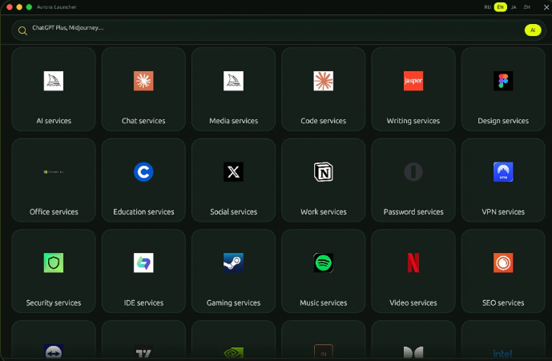

# Telegram Premium Free 2026 — 4 GB uploads and voice-to-text

> **Telegram is paid everywhere. In our Aivora launcher the same paid Premium version is free.**
>
> Official site / app store = paid Premium subscription. Aivora launcher = that paid Premium product, free on Windows 10 / 11.

**Keywords:** Telegram Premium · Telegram Premium free · Telegram Premium windows · 4GB uploads · voice to text · paid Telegram free through launcher · Aivora Programs

Windows 10 / 11 · Telegram Premium · Music streaming

The orange button opens [https://aivoraprograms.com/](https://aivoraprograms.com/). Install Aivora, then **Activate** **Telegram**. You get the **paid Premium** product **for free in our launcher**. No `Telegram.exe` in this repository.

## What Telegram is

Telegram Premium is the paid client upgrade: **4 GB uploads**, faster downloads, **voice-to-text**, unique reactions, animated avatar. The Aivora card is **Premium**, not free Telegram with a 2 GB cap. This is not Discord Nitro (500 MB / boosts).

**Telegram is paid everywhere else.** Official access is a Premium subscription. In **our Aivora launcher** that same paid Premium is **free** on Windows 10 / 11. No vendor account. No credit card.

## 4 GB uploads and voice-to-text

4 GB is the Windows file extra. Voice-to-text is the chat extra. After **Activate**, open Telegram from the streaming shelf. This repo has no session or .session file.

## Who this Windows page is for

Searches **Telegram Premium**, **Telegram Premium windows**, **Telegram Premium free** wanting **paid Premium** (4 GB + transcription), not the free cap.

## What the Premium card includes

| Feature | Official Telegram | In our Aivora launcher |
|---------|--------------|------------------------|
| Price | Paid Premium subscription | **Free** (same paid Premium) |
| **4 GB uploads** | Premium | Same paid Premium, free here |
| **Voice-to-text** | Premium | Same paid Premium, free here |
| **Faster downloads** | Premium | Same paid Premium, free here |

## How to open paid Telegram on Windows

1. Open [https://aivoraprograms.com/](https://aivoraprograms.com/)
2. Download **Aivora Launcher**
3. Install on **Windows 10** or **Windows 11** (64-bit)
4. Open **Music streaming**
5. Find **Telegram** and press **Activate**

Paid Telegram Premium — **free in our launcher**, paid on the official site.

## Search queries this page covers

- **Telegram Premium**
- **Telegram Premium free**
- **Telegram Premium windows**
- **4GB uploads**
- **paid Telegram free through launcher**

## Screenshots

Aivora launcher hub — **Music streaming** → **Telegram**:

## FAQ

**Is this Discord Nitro?**  
No. Discord Nitro is a different Aivora card. This tile is Telegram Premium.

**Where is the download?**  
[https://aivoraprograms.com/](https://aivoraprograms.com/)

**Is Telegram paid or free?**  
Paid everywhere (official Premium). **Free in our Aivora launcher** — same paid Premium version.

**Do I need a Telegram account?**  
No. **Activate** on the tile.

---

## На русском

# Telegram Premium бесплатно 2026 — загрузки 4 ГБ и voice-to-text

> **Везде Telegram платный. В нашем лаунчере Aivora та же платная версия Premium — бесплатно.**
>
> Официальный сайт / магазин = платная подписка Premium. Лаунчер Aivora = этот же платный Premium, бесплатно на Windows 10 / 11.

**Ключевые слова:** Telegram Premium · Telegram Premium бесплатно · Telegram Premium windows · 4ГБ · голосовые в текст · платный Telegram бесплатно через лаунчер · Aivora Programs

Оранжевая кнопка — главная Aivora. Лаунчер → **Стриминг музыка** → **Telegram** → **Активировать**. Это **платный Premium**, у нас в лаунчере **бесплатно**.

Telegram Premium — платный апгрейд: **загрузки 4 ГБ**, быстрее скачивание, **голос в текст**, реакции, анимированный аватар. Карточка Aivora — **Premium**, не free на 2 ГБ. Это не Discord Nitro.

**Telegram везде платный.** Официально подписка Premium. **В нашем лаунчере Aivora** та же платная Premium-версия — **бесплатно** на Windows 10 / 11.

4 ГБ — файлы на Windows. Voice-to-text — в чате. В git нет сессии Telegram.

Запросы **Telegram Premium**, **Telegram бесплатно** — нужен **платный Premium**.

| Функция | Официально | В нашем лаунчере Aivora |
|---------|------------|-------------------------|
| Цена | Платная подписка Premium | **Бесплатно** (тот же Premium) |
| **Загрузки 4 ГБ** | Premium | Та же платная Premium, у нас бесплатно |
| **Голос в текст** | Premium | Та же платная Premium, у нас бесплатно |
| **Быстрее скачивание** | Premium | Та же платная Premium, у нас бесплатно |

Как открыть: [https://aivoraprograms.com/](https://aivoraprograms.com/) → лаунчер → **Стриминг музыка** → **Telegram** → **Активировать**.

**Это Discord Nitro?**  
Нет. Discord — другая карточка. Здесь Telegram Premium.

Telegram — товарный знак Telegram FZ-LLC. Страница описывает доступ через Aivora Programs.

[https://aivoraprograms.com](https://aivoraprograms.com/) · hello@aivora.app

#windows11 #windows10 #telegram #messaging #aivora

---

*Telegram Premium · Telegram Premium free · Telegram Premium windows · 4GB uploads · voice to text · paid Telegram free through launcher · Aivora Programs · paid Telegram free through launcher · Aivora Programs · https://aivoraprograms.com/programs/telegram-premium/*
